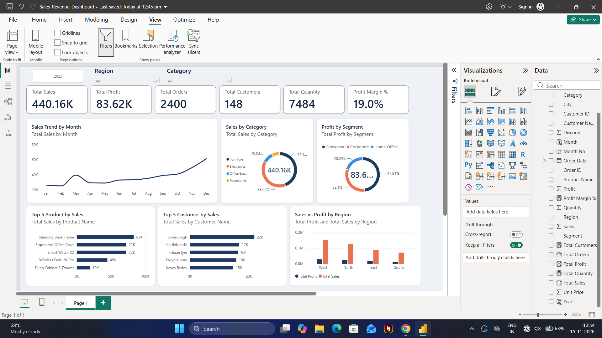

# Sales & Revenue Analysis Dashboard (Power BI)

An interactive Power BI dashboard that analyzes sales and revenue data and tracks key business KPIs.

## Objective
Build a dashboard to analyze sales and revenue: import data, visualize KPIs (total sales, revenue trends, top-performing products) and enable interactive analysis with charts, filters and slicers.

## Dataset
`data/sales_data.csv` – 2,400 orders (Jan–Dec 2025), 148 customers, 4 categories, 26 products, 4 regions.
> **Note:** This is a **synthetic dataset** generated for this exercise (Python, fixed random seed), not real company data. Figures are illustrative.

| Column | Description |
|---|---|
| Order ID, Order Date | Order identifier and date |
| Customer ID, Customer Name, Segment | Customer details (Consumer / Corporate / Home Office) |
| Region, City | Location |
| Category, Product Name | Product hierarchy |
| Quantity, Unit Price, Discount | Order line details |
| Sales, Profit | Revenue after discount and profit |

## KPIs (DAX – see `dax_measures.txt`)
Total Sales · Total Profit · Total Orders · Total Customers · Total Quantity · Profit Margin % · Average Order Value

## Visuals
- KPI cards
- Monthly sales trend (line/area)
- Sales by category (donut)
- Profit by segment (donut)
- Top 5 products and top 5 customers (bar)
- Sales vs profit by region (clustered column)
- Slicers: Year, Region, Category

## Key Insights
.Total sales are about 440K with a profit of about 84K, a margin of about 19%.
.Furniture (44%) and Electronics (39%) generate most of the revenue.
.Standing Desk Frame, Ergonomic Office Chair and Smart Watch X2 are the top products.
.Sales rise through the year and peak in Q4 (Nov and Dec).
.West and North lead on sales, while South is the lowest.

## Tools
Power BI Desktop, Power Query, DAX, Python (data generation).

